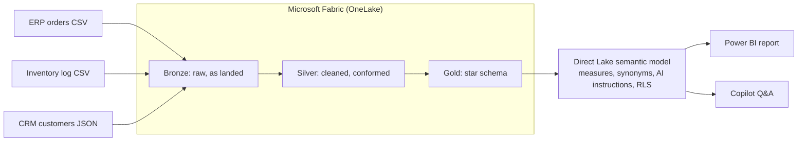

# AI-Ready Lakehouse & Copilot PoC — NorthPeak Industrial Supply

> **Microsoft Fabric · OneLake · Lakehouse · Medallion Architecture · Direct Lake · Semantic Modeling · DAX · Copilot for Power BI**

A 4-day proof-of-concept that unifies three siloed systems (ERP, inventory logs, CRM) into a Fabric Lakehouse and exposes a **Copilot-ready semantic model**, so an executive can ask questions in plain English and get answers that match the numbers.

**All data is synthetic.** The company, customers, and figures are fictional and generated by `generate_synthetic_data.py`.

---

## 1. The business problem

NorthPeak is a fictional Canadian B2B distributor of industrial supplies. Leadership can't get a straight answer to questions like:

- *Which product categories are losing margin, and since when?*
- *Where are we stocking out, and which warehouse?*
- *Who are our top customers this year, and are we over-discounting to them?*

Orders live in the ERP, stock levels in warehouse CSV logs, and customers in the CRM. Customer keys, SKUs, warehouse names, dates, and segment labels all disagree across systems.

**Goal:** one trusted data foundation and a semantic model that Copilot can answer from without guessing.

## 2. Architecture



*(Replace with an exported diagram image once the build is final. Add Copilot screenshots under `/docs/screenshots`.)*

## 3. Data sources and the problems injected

| Source | Format | Key problems (deliberate) |
|---|---|---|
| ERP orders | CSV | 3 date formats (incl. `dd/mm/yyyy`), prices like `$59.00`, discounts as `0.12` or `12%`, status casing, ~2% exact duplicate rows, missing quantities, some customer IDs without the dash |
| Inventory log | CSV | SKU written 3 ways, 4 spellings per warehouse, 3 timestamp styles, ~1% null stock, thousands separators in costs |
| CRM | JSON | Customer key `C00123` vs ERP `C-00123`, ~3% duplicate accounts, inconsistent segment/province labels, company name variants, 20 customers missing entirely |

Exact counts for each run are printed by the generator and saved in `ground_truth.json` under `injected_defects`.

## 4. Medallion layers

| Layer | What happens | Tooling |
|---|---|---|
| **Bronze** | Land files unchanged; add `_ingested_at` and `_source_file` | Lakehouse Files → Delta tables |
| **Silver** | Parse dates/prices/discounts, normalize keys (strip dashes, upper-case), standardize SKU, map warehouse names to codes, standardize segment/province, dedupe, flag nulls, exclude cancelled orders from revenue | `[TODO: Dataflows Gen2 / PySpark notebook]` |
| **Gold** | `fact_order_line`, `fact_inventory_snapshot`, `dim_customer`, `dim_product`, `dim_warehouse`, `dim_date` | `[TODO]` |

Silver data-quality rules and row counts (raw → clean) live in `docs/silver_rules.md` `[TODO]`.

## 5. Semantic model (built for Copilot)

- **Star schema**, one grain per fact table, relationships on surrogate or clean keys.
- **Business-friendly names** (`Net Revenue`, not `calc_rev_v2`); technical keys and staging columns hidden.
- **Explicit DAX measures only**: no implicit aggregations that Copilot could misinterpret.
- **Descriptions and synonyms** on key tables, columns, and measures (e.g. *margin* → Gross Margin %, *client* → Customer).
- **AI instructions** that define business rules (cancelled orders excluded; revenue is net of discount; fiscal vs calendar quarter).
- **Row-level security:** `[TODO: e.g. regional manager sees only their warehouse/region]`.

Starter measures to adapt:

```DAX
Net Revenue =
SUMX(
    FILTER(fact_order_line, fact_order_line[status] <> "Cancelled"),
    fact_order_line[qty] * fact_order_line[unit_price] * (1 - fact_order_line[discount_pct])
)

COGS =
SUMX(
    FILTER(fact_order_line, fact_order_line[status] <> "Cancelled"),
    fact_order_line[qty] * fact_order_line[unit_cost]
)

Gross Margin % = DIVIDE([Net Revenue] - [COGS], [Net Revenue])

Net Revenue PY = CALCULATE([Net Revenue], SAMEPERIODLASTYEAR(dim_date[date]))
Net Revenue YoY % = DIVIDE([Net Revenue] - [Net Revenue PY], [Net Revenue PY])

Stockout Snapshots =
CALCULATE(COUNTROWS(fact_inventory_snapshot), fact_inventory_snapshot[on_hand_qty] = 0)
```

## 6. Copilot accuracy test

I wrote executive-style prompts, compared Copilot's answers against `ground_truth.json` (computed from the clean data before defects were injected), then changed the model and re-tested.

| # | Prompt | Expected (from ground truth) | Copilot, 1st pass | Fix applied | Copilot, after fix |
|---|---|---|---|---|---|
| 1 | Which category had the biggest margin drop in Q3 2026? | Electrical (~42% → ~33%) | `[TODO]` | `[TODO]` | `[TODO]` |
| 2 | Where did we run out of stock this summer? | Calgary DC, Safety Gear | `[TODO]` | `[TODO]` | `[TODO]` |
| 3 | Which customer segment gets the highest average discount? | Enterprise (~12%) | `[TODO]` | `[TODO]` | `[TODO]` |
| 4 | Who were our top 5 customers in 2026? | See ground truth | `[TODO]` | `[TODO]` | `[TODO]` |
| 5 | How did revenue trend by quarter? | See ground truth | `[TODO]` | `[TODO]` | `[TODO]` |

**Result:** `[TODO: X of Y prompts correct on first pass → X of Y after tuning]`

> Note: 2026-Q4 contains data only through Oct 31. Copilot availability depends on Fabric capacity. `[TODO: state what you actually ran Copilot on]`

## 7. How to reproduce

1. Generate the data:
   ```bash
   python generate_synthetic_data.py --out ./data      # standard library only
   ```
   Options: `--orders`, `--customers`, `--seed`. The default seed (42) makes every run identical.
2. In a Fabric workspace, create a Lakehouse and upload the three files to `Files/bronze/`.
3. Run the Silver and Gold steps `[TODO: link notebook / dataflow]`.
4. Create the Direct Lake semantic model on the Gold tables and apply the measures, synonyms, and AI instructions above.
5. Open the report and test with the prompts in section 6.

## 8. Key decisions and trade-offs

- **Direct Lake over Import:** `[TODO: your reasoning]`
- **Medallion in one Lakehouse, not three:** `[TODO]`
- **Scoped for a 3–4 week PoC:** what I deliberately left out: `[TODO, e.g. incremental refresh, CI/CD, data contracts]`

## 9. Limitations and next steps

- Synthetic data is simpler than real client data (clean business rules, no late-arriving records).
- Next: incremental loads with pipelines, data-quality alerts, deployment pipelines for dev/test/prod, expanding the prompt test set.

## Repo structure

```
generate_synthetic_data.py   # creates the 3 messy sources + ground_truth.json
data/                        # generated files (git-ignored)
notebooks/                   # Silver/Gold transformations
docs/                        # architecture diagram, screenshots, silver_rules.md
README.md
```
